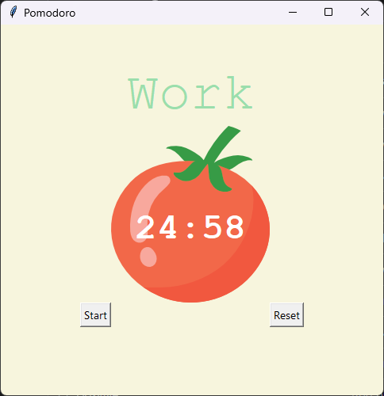
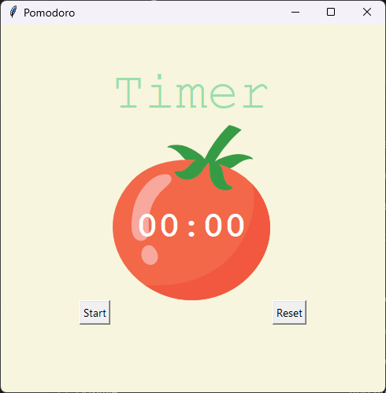
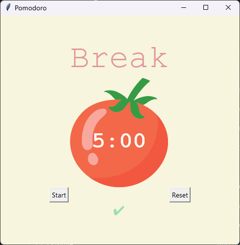

# Pomodoro Timer

A Tkinter Pomodoro timer in Python: Day 28 of Udemy's *100 Days of Code: The Complete Python Pro Bootcamp*. It alternates 25 minutes of work with 5-minute breaks, adds a check mark for every finished work session and takes a 20-minute break after four of them. Built for course participants who want to compare solutions and for anyone browsing for ideas. It has no runtime dependencies beyond the Python standard library.



More: the [wiki](https://git.tirsystem.com/Tirsvad-Udemy-100-days-of-code/028-pomodoro/wiki) in English, Danish and Bahasa Malaysia.

## Requirements

- Python 3.13 or later, with Tkinter (the standard library's GUI toolkit)
- `venv` and `pip` (come with Python)
- For the tests: `pytest` (installed by the `dev` extra below)
- For the source documentation: [Doxygen](https://www.doxygen.nl/) (optional)

## Set up

Clone the repository, then create a local virtual environment `.venv` in its root, upgrade `pip` and install the project with the development tools. The `framework/` folder is a git submodule with the project's quality process; it is not needed to run the program, so a plain `git clone` is enough.

```text
git clone ssh://git@git.tirsystem.com:10022/Tirsvad-Udemy-100-days-of-code/028-pomodoro.git
cd 028-pomodoro
```

### Windows powershell

Install Python 3.13 or later from [python.org](https://www.python.org/downloads/) (it includes Tkinter), then:

```powershell
python -m venv .venv
.\.venv\Scripts\Activate.ps1
python -m pip install --upgrade pip
python -m pip install -e ".[dev]"
```

If PowerShell refuses to run the activation script, run `Set-ExecutionPolicy -Scope Process RemoteSigned` first, or call the interpreter directly as `.\.venv\Scripts\python.exe`.

### Linux debian

```bash
sudo apt install python3 python3-venv python3-tk
python3 -m venv .venv
source .venv/bin/activate
python -m pip install --upgrade pip
python -m pip install -e ".[dev]"
```

Debian ships Tkinter in the separate package `python3-tk`. Use `python3.13` instead of `python3` when the default Python is older than 3.13.

### MacOS

```bash
brew install python@3.13 python-tk@3.13
python3.13 -m venv .venv
source .venv/bin/activate
python -m pip install --upgrade pip
python -m pip install -e ".[dev]"
```

Python from [python.org](https://www.python.org/downloads/) already includes Tkinter, so `python-tk` is only needed with Homebrew.

To leave the virtual environment, run `deactivate`. To use it again later, run the activation command of your platform again.

## Run

With the virtual environment active:

```bash
python -m pomodoro
```

Press **Start** to begin a 25-minute work session. The timer rolls on by itself: work, short break, work, short break, work, short break, work, long break. Each finished work session adds a check mark. **Reset** stops the timer and clears everything. Without installing the package you can run `PYTHONPATH=src python -m pomodoro` (PowerShell: `$env:PYTHONPATH = "src"; python -m pomodoro`).

| Idle | Work session | Break |
| --- | --- | --- |
|  |  |  |

## Run the tests

```bash
python -m pytest
```

The tests of the timer rules need no display. `tests/test_workflows.py` is a static test of the files in `.gitea/workflows/`: valid YAML without duplicate keys, the required keys, explicit permissions, a runner and a timeout per job, actions pinned to an exact tag or commit, and no inline script above five lines. The window and controller tests are skipped when Tkinter or a display is not available (on Linux without a display, run `xvfb-run -a python -m pytest`). For a coverage report add `--cov=pomodoro`; for the style and type checks run:

```bash
python -m ruff check src tests
python -m ruff format --check src tests
python -m mypy
```

## Continuous integration

The workflow [`.gitea/workflows/ci.yml`](.gitea/workflows/ci.yml) runs on every pull request to `main` and on pushes to `main`. It sets up Python 3.13, installs the project with the `dev` extra, runs `ruff`, `mypy --strict` and `pytest` with coverage under a virtual display. It is written for Gitea Actions and also runs on GitHub Actions.

## Build the source documentation

The source comments use Doxygen commands. With [Doxygen](https://www.doxygen.nl/) installed (`sudo apt install doxygen`, `brew install doxygen`, or the Windows installer), run from the repository root:

```bash
doxygen Doxyfile
```

The HTML documentation is written to `docs/doxygen/html/index.html` (ignored by git).

## Project layout

```text
.gitea/workflows/ci.yml   continuous integration
docs/                     project documents (business case, plan, milestones, reviews),
                          images and the wiki sources
framework/                SQA and QC framework (git submodule, not needed to run)
src/pomodoro/             the package
    constants.py            colours, font, durations and UI values
    timer_rules.py          pure rules of the cycle (no Tkinter)
    app.py                  the window: start_timer, count_down, reset_timer
    main.py, __main__.py    entry point (python -m pomodoro)
tests/                    pytest tests (rules, window, workflow files)
Doxyfile                  Doxygen configuration
pyproject.toml            project, pytest, ruff and mypy configuration
```

## License

GNU Affero General Public License v3.0. See [LICENSE](LICENSE).
