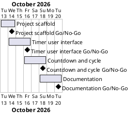

# Project Plan: Pomodoro Timer

## Metadata
| Key | Value |
| --- | --- |
| ID | PP-001 |
| CrossReference | [BC-001], [SA-001], [MIL-001], [MIL-002], [MIL-003], [MIL-004] |
| Language | en |
| Domain | it |

## Version History
| Date | Status | Author | Reviewer | Change | Commit |
| --- | --- | --- | --- | --- | --- |
| 2026-10-13 | Accepted | AI for S01 | AI as stand-in for S01 | Initial version; accepted by AI as stand-in for S01 (no checklist for PP) | pending |

---

## Purpose

This plan schedules the four phases (gateways) that deliver the Pomodoro timer of [BC-001] inside its constraint of one week, from 2026-10-13 to 2026-10-20. Each phase is one pull request and one Milestone on the git host; its tasks are the Issues the pull request closes.

## Planning Assumptions

- The plan starts 2026-10-13 and ends by 2026-10-20, per the Business Case constraint.
- Phases are short (about two days) because the application is one screen; S01 reviews per pull request, as [SA-001] sets.
- Each phase is a branch and a pull request: `mil-001-project-scaffold`, `mil-002-timer-ui`, `mil-003-countdown-cycle`, `mil-004-documentation`.
- The baseline documents (this plan, [BC-001], [SA-001] and the four milestones) are delivered by their own pull request, `baseline-plan`, before any code.
- No use case or user story documents are written. The application has one screen and three user actions; their behaviour is stated as the Go/No-Go criteria of [MIL-002] and [MIL-003] and as tests. The tasks are therefore marked as needing no use case. S01 may challenge this when accepting the plan.

## Gateway Schedule

| Gateway | Document | Window | Decision date | Owner | Stories | Main deliverable | Milestone |
| --- | --- | --- | --- | --- | --- | --- | --- |
| Project scaffold | [MIL-001] | 2026-10-13 to 2026-10-14 | 2026-10-14 | S01 | none | Configuration, layout, constants, Doxyfile, continuous integration | |
| Timer user interface | [MIL-002] | 2026-10-14 to 2026-10-16 | 2026-10-16 | S01 | none | Window with tomato, labels and buttons | |
| Countdown and cycle | [MIL-003] | 2026-10-16 to 2026-10-18 | 2026-10-18 | S01 | none | Working Pomodoro cycle with tests | |
| Documentation | [MIL-004] | 2026-10-18 to 2026-10-20 | 2026-10-20 | S01 | none | README, wiki in three languages, description and topics | |



## Scope Coverage

| Business Case scope item | Gateway |
| --- | --- |
| Timer application and its tests under `src/` and `tests/` | [MIL-002], [MIL-003] |
| `pyproject.toml`, `constants.py`, Python `.gitignore`, `Doxyfile`, continuous integration | [MIL-001] |
| README, wiki in three languages, screenshots | [MIL-004] |
| Repository description and topics | [MIL-004] |
| Planning documents and one pull request per milestone | This plan, all gateways |

## Dependencies

```
baseline-plan → MIL-001 → MIL-002 → MIL-003 → MIL-004
```

A No-Go on a gateway moves every later date by the rework time; the end date 2026-10-20 has about one day of slack inside the four windows.

## Plan Risks

| Risk | Impact | Mitigation |
| --- | --- | --- |
| The wiki repository of the git host is not enabled or not writable with the token | Wiki cannot be published in [MIL-004] | Keep the wiki pages as files in the repository and report it in the run summary |
| Review stand-in cannot satisfy the language criteria of a person | A gateway stays on Go-with-conditions | Record it, list it in the run summary and let S01 confirm |
| Runner for continuous integration is missing on the git host | Continuous integration stays unverified | Verify the workflow file statically and report that no run was observed |

## Open Issues

- S01 confirms in the run summary the stand-in decisions, the choice not to write use cases, and the language criteria 3, 5 and 9 of `QC-LANG-001`.
- `PP` has no QC checklist yet (framework open item); the plan is validated against the Go/No-Go criteria of its milestones.

---

[BC-001]: ./business-case.md
[SA-001]: ./stakeholder-analysis.md
[MIL-001]: ./milestones/mil-001-project-scaffold.md
[MIL-002]: ./milestones/mil-002-timer-ui.md
[MIL-003]: ./milestones/mil-003-countdown-cycle.md
[MIL-004]: ./milestones/mil-004-documentation.md
